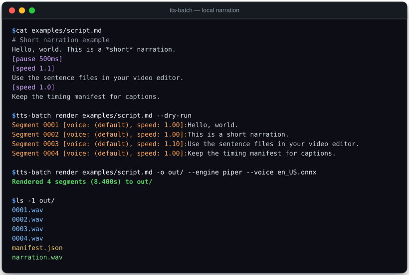

# tts-batch

Turn UTF-8 text scripts into local narration, numbered sentence WAVs and a JSON caption timeline.

[](https://github.com/YusufBeratZengin/tts-batch/actions/workflows/ci.yml)
[](https://pypi.org/project/tts-batch/)
[](https://www.python.org/downloads/)
[](LICENSE)

[Türkçe](README.tr.md) · [Contributing](CONTRIBUTING.md) · [Changelog](CHANGELOG.md)

<p align="center">
  
</p>

## Why tts-batch?

- **Zero cloud / 100% offline**: Runs completely on your local workstation using Piper (ONNX), espeak-ng, or Kokoro. Zero API keys, zero monthly subscriptions, and zero audio data leaving your machine.
- **Video-editor & caption ready**: Generates individual numbered WAV files for each sentence plus a unified `narration.wav` and an integer-frame JSON timing manifest for direct drag-and-drop into DaVinci Resolve, Premiere, or subtitle pipelines.
- **Pure standard-library core**: Zero external runtime dependencies for the core package. Features $O(1)$ streaming concatenation directly to disk, pure Python RMS/peak normalization, and deterministic SHA-256 asset caching.

## Quick start

### 1. Install

Install `tts-batch` using pip:

```sh
# From PyPI
python -m pip install tts-batch

# Or from a local clone
python -m pip install -e .
```

### 2. Inspect script (Dry Run)

Test sentence splitting and pacing without invoking a TTS engine:

```sh
tts-batch render examples/script.md --dry-run
```

Output:
```text
Segment 0001 [voice: (default), speed: 1.00]: Hello, world.
Segment 0002 [voice: (default), speed: 1.00]: This is a short narration.
Segment 0003 [voice: (default), speed: 1.10]: Use the sentence files in your video editor.
Segment 0004 [voice: (default), speed: 1.00]: Keep the timing manifest for captions.
```

### 3. Render narration

Render speech using the built-in `espeak` engine fallback:

```sh
tts-batch render examples/script.md -o out/ --engine espeak --voice en
```

Or synthesize Turkish narration with Turkish abbreviations and ordinal dates:

```sh
tts-batch render examples/script.tr.md -o out/ --engine espeak --voice tr
```

`python -m tts_batch` is equivalent to `tts-batch`.

## Usage examples

### Script markup and format

Scripts can be `.txt` or `.md` files encoded as UTF-8 (UTF-8 BOM is accepted):

```markdown
# Lines starting with # are ignored comments
Hello, world. This is a *short* narration.
[pause 500ms]
[speed 1.1]
This section is read slightly faster.
[voice models/another.onnx]
This section uses a different voice.
```

| Directive | Description |
| --- | --- |
| `[pause 500ms]` | Add silence duration (milliseconds); decimal values like `250.5ms` accepted |
| `[speed 1.1]` | Set speech speed multiplier for subsequent sentences; default `1.0` |
| `[voice path/or/id]` | Set active voice or model for subsequent speech; paths may contain spaces |
| `*emphasis*` | Asterisks are stripped automatically; ignored by audio adapters |
| `# Comment` | Whole line is ignored when `#` is the first non-whitespace character |

Directives take effect immediately and flush preceding speech into an independent segment. Voice and speed persist across lines until changed.

### Engine options

Install your preferred engine binary or models separately:

1. **Piper (Neural ONNX)**: High-quality local neural synthesis. Requires `piper` on PATH, a local `.onnx` voice model, and its adjacent `.onnx.json` sidecar.
   ```sh
   tts-batch render examples/script.md -o out/ --engine piper --voice models/en_US.onnx
   ```
2. **espeak-ng (Fast fallback)**: Ultra-fast local synthesis. Requires `espeak-ng` or `espeak` on PATH.
   ```sh
   # List installed voices
   tts-batch --list-voices

   # Render with a specific language code
   tts-batch render examples/script.md -o out/ --engine espeak --voice en
   ```
3. **Kokoro (Optional neural adapter)**:
   ```sh
   python -m pip install -e ".[kokoro]"
   tts-batch render examples/script.md -o out/ --engine kokoro \
     --kokoro-model models/kokoro-v1_0.pth \
     --kokoro-config models/config.json --voice voices/af_heart.pt --lang a
   ```
   Requires local `.pth` weights, config JSON, and `.pt` voice tensor. The adapter sets `HF_HUB_OFFLINE=1` and `TRANSFORMERS_OFFLINE=1` for offline safety. Supported language codes: `a` (US English), `b` (UK English), `e` (Spanish), `f` (French), `h` (Hindi), `i` (Italian), `p` (Portuguese), `z` (Mandarin).

### Python API

You can also render scripts directly in Python using standard classes:

```python
from pathlib import Path
from tts_batch import render
from tts_batch.engines import EspeakEngine

manifest = render(
    "Hello, world. This is python narration.",
    Path("out"),
    EspeakEngine(),
    voice="en",
    gap=0.2,
    normalization="rms",
    target_db=-20.0,
)
print(f"Rendered {len(manifest['sentences'])} sentences to {manifest['audio']}")
```

## Configuration

### Command-line options

```sh
tts-batch render <script.md> -o <output_dir> [options]
```

| Option | Default | Description |
| --- | --- | --- |
| `-o, --output` | *(required)* | Destination directory for audio files and manifest |
| `--engine` | `espeak` | TTS engine adapter (`piper`, `espeak`, `kokoro`) |
| `--voice` | `""` | Voice model path (Piper/Kokoro) or language identifier (espeak) |
| `--speed` | `1.0` | Global speech speed multiplier (> 0) |
| `--gap` | `0.2` | Inter-segment gap duration in seconds added to `narration.wav` |
| `--normalize` | `rms` | Audio normalization strategy: `rms`, `peak`, or `none` |
| `--target-db` | `-20.0` | Target dBFS level (range -120 to 0 dBFS) |
| `--dry-run` | `false` | Parse and print speech segments without synthesizing audio |
| `--list-voices` | `false` | List available voice tags from local `espeak-ng` |
| `--cache-dir` | `OUTPUT/.cache` | Directory storing deterministic WAV synthesis cache |
| `--no-cache` | `false` | Disable synthesis caching and force re-generation |

### Output structure & manifest schema

Every render run populates the destination directory:

```text
out/
  0001.wav          # First sentence speech audio
  0002.wav          # Second sentence speech audio
  narration.wav     # Full concatenated narration including gaps and pauses
  manifest.json     # Timing metadata and caption alignment
  .cache/           # SHA-256 synthesis cache
```

Running `tts-batch render` prints a concise status summary:

```text
Rendered 2 segments (2.000s) to out/
```

The resulting `out/manifest.json` provides sentence and estimated word timings:

```json
{
  "schema_version": 1,
  "engine": "stub",
  "audio": "narration.wav",
  "sample_rate": 16000,
  "channels": 1,
  "duration": 2.0,
  "frames": 32000,
  "gap_seconds": 0.2,
  "normalization": "rms",
  "target_dbfs": -20.0,
  "word_timing": "estimated_character_weight",
  "sentences": [
    {
      "text": "Hello, world.",
      "file": "0001.wav",
      "voice": "",
      "speed": 1.0,
      "start": 0.0,
      "end": 0.6,
      "start_frame": 0,
      "end_frame": 9600,
      "duration": 0.6,
      "cache_hit": false,
      "cache_key": "a362ec42341e2f77fcff42ef970afa0c3adfe7b02accbdb38310db9892b79e65",
      "words": [
        {
          "text": "Hello",
          "start": 0.0,
          "end": 0.3
        },
        {
          "text": "world",
          "start": 0.3,
          "end": 0.6
        }
      ]
    },
    {
      "text": "This is a short narration.",
      "file": "0002.wav",
      "voice": "",
      "speed": 1.0,
      "start": 0.8,
      "end": 2.0,
      "start_frame": 12800,
      "end_frame": 32000,
      "duration": 1.2,
      "cache_hit": false,
      "cache_key": "10ced23c9fd24e29c4c8ff3463649d65f8881d21f74ba4db47c70632945f40c7",
      "words": [
        {
          "text": "This",
          "start": 0.8,
          "end": 1.0285625
        },
        {
          "text": "is",
          "start": 1.0285625,
          "end": 1.142875
        },
        {
          "text": "a",
          "start": 1.142875,
          "end": 1.2
        },
        {
          "text": "short",
          "start": 1.2,
          "end": 1.4856875
        },
        {
          "text": "narration",
          "start": 1.4856875,
          "end": 2.0
        }
      ]
    }
  ]
}
```

## FAQ & Limitations

- **Audio format constraints**: All engine output must be uncompressed 16-bit PCM WAV. All segments within a single render must share the identical sample rate and channel count (no implicit resampling).
- **Word timing estimation**: Sentence boundaries are exact, calculated from audio sample frames. Word timestamps are character-weighted estimates (`word_timing: "estimated_character_weight"`), not forced acoustic alignments.
- **Engine binaries and models**: This package does not download or bundle engine binaries (`espeak`, `piper`) or voice weights. Engine licenses are independent of this project's MIT license.
- **Concurrency & atomic staging**: Renders stage output files before updating `narration.wav` and `manifest.json`. However, filesystem-level directory replacement is not transactional. Do not point concurrent renders to the same output directory.

## Contributing

Contributions are welcome!

```sh
# Set up development environment
python -m pip install -e ".[dev]"

# Run code style and format checks
python -m ruff check .
python -m ruff format --check .

# Run strict type checking
python -m mypy

# Run test suite with line coverage
python -m pytest --cov=tts_batch
```

See [CONTRIBUTING.md](CONTRIBUTING.md) for contribution guidelines and [SECURITY.md](SECURITY.md) for security policy.

## License

This project is licensed under the [MIT License](LICENSE).
